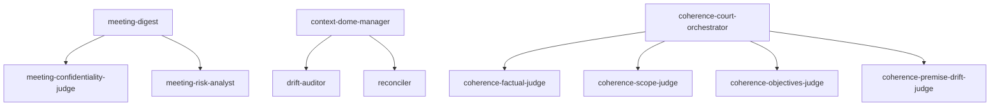

# Agent Invocation Graph

> Generated: 2026-11-11T16:32:05Z | SE-270 Slice 4
> Max detected depth: **1** (limit: 2) — **PASS**
> Deepest path: `meeting-digest → meeting-confidentiality-judge`

## Graph

## Delegation Table

| Caller | Allowed Targets |
|---|---|
| meeting-digest | meeting-confidentiality-judge,meeting-risk-analyst |
| context-dome-manager | drift-auditor,reconciler |
| coherence-court-orchestrator | coherence-factual-judge,coherence-scope-judge,coherence-objectives-judge,coherence-premise-drift-judge |

---
Generated by scripts/agent-depth-limit.sh
